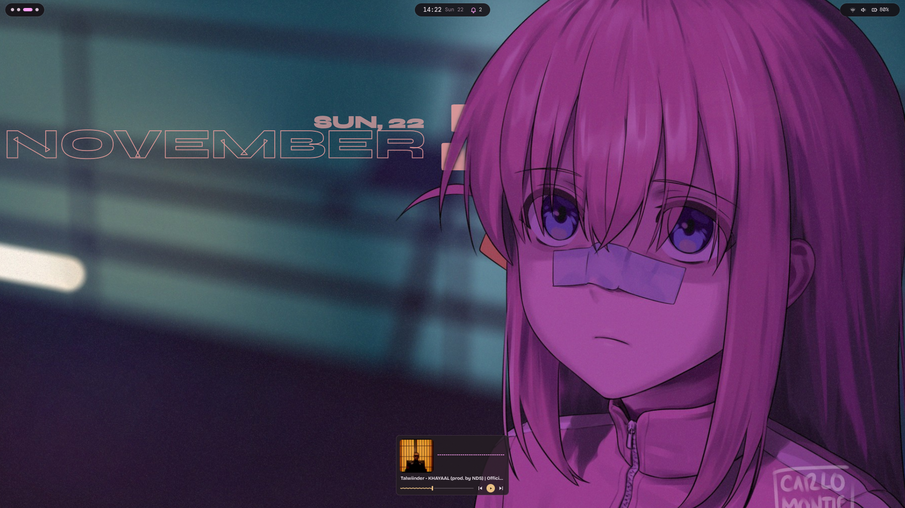
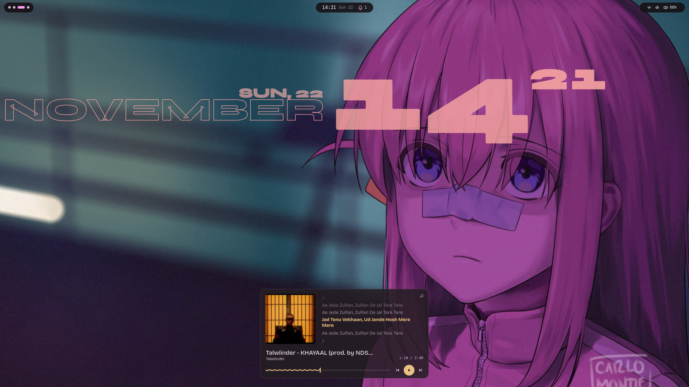
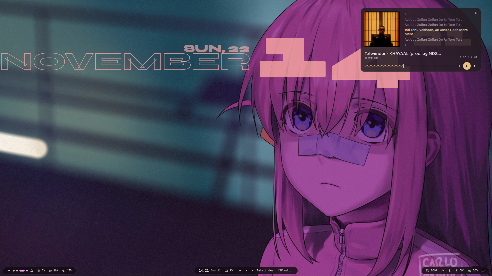

# kajukatli

A desktop shell for Arch Linux and Hyprland that builds its colours and clock from the active wallpaper.

## Preview

| | | |
|---|---|---|
|  |  |  |

## Features

- Wallpaper-aware **Material You-style themes**: vibrant, tonal, or monochrome; dark, light, or automatic.
- **Six clock layouts** with optional depth compositing behind the subject of an anime or photo wallpaper.
- A responsive **desktop shell** with docks, floating bars, islands, rails, widgets, panels, notifications, and a lock screen.
- **Live visuals**: Cava waves, bars, or mirrors; lyrics, calendars, system stats, weather, and media controls.
- **Seven looks** that configure the whole desktop in one click.
- **Automatic power saving** on battery, including disabling blur, shadows, live wallpapers, and cursor parallax.
- A **guided installer** that separates essential packages from optional extras and asks before changing system files. It also keeps a copy of everything it changes, so `--rollback` and `./uninstall.sh --all` can put it back.
- A **control center** where one tap switches Wi-Fi or Bluetooth. Bluetooth devices stay saved and reconnect by themselves, each device has its own controls, and the battery page shows health, watts, cycles and the last 24 hours.
- **Your phone** on the desktop through KDE Connect: battery, ring it, send files and the clipboard, browse its storage, read texts.
- A **task manager** (`Ctrl + Shift + Esc`) with processes, memory, storage clean-up, the recycle bin and drives (mount, eject, format).
- **Software** (`Super + Shift + I`): the official repos, the AUR and Flathub in one search, plus installed apps, updates and one-click developer setups.
- **Every running app one tap away**, including the ones without a window, with quit and force quit.
- **Graphics control** on hybrid laptops: integrated, both, or NVIDIA only; switch the NVIDIA card off completely; heavy apps (games, Blender) start on it.

## Looks

Switch with `Super + I`, `Super + Shift + T`, or `kk-look <name>`:

| Look | Bar | Desktop |
|---|---|---|
| `tide` | Floating pill, top | Stacked clock, audio wave, dock |
| `ronin` | Left rail | Giant date, visualiser, player card |
| `komorebi` | Floating pill, top | Hollow-seconds clock, calendar, dock |
| `currents` | Long bar, bottom | Weather, time chip, weekday, lyrics card |
| `dreamer` | Three islands, top | Line clock, system stats, tall player |
| `grove` | None | Serif clock, dock |
| `print` | Long bar, top | Original monochrome Kajukatli style |

Every setting can be changed independently after choosing a look. Use `Super + Shift + E` to drag desktop widgets; positions are stored as fractions of the screen.

## Installation

### 1. Prepare Arch Linux

For a fresh Arch installation, boot the ISO, connect to the internet, and run:

```sh
archinstall
```

Choose a minimal profile, create a regular user with `sudo`, enable NetworkManager, and enable PipeWire for audio.

### 2. Install Kajukatli

```sh
sudo pacman -S --needed git
# only the dotfiles: the newest version, without history or the preview screenshots
git clone --depth 1 --filter=blob:none --sparse https://github.com/yashmish18/dotfiles.git ~/dotfiles
cd ~/dotfiles
git sparse-checkout set --no-cone '/*' '!/assets/'
./install.sh
```

The installer creates a backup before linking configuration and offers these extras:

| # | Extra | Contents |
|---|---|---|
| 1 | Apps | File manager, browser, video player, mixer, Bluetooth and Wi-Fi tools |
| 2 | Capture | Screenshot editor, recorder, and colour picker |
| 3 | Visualiser | Cava |
| 4 | Live wallpapers | MP4, WebM, MKV, MOV, and GIF support through mpvpaper |
| 5 | Terminal | Starship, Fastfetch, Eza, Bat, Zoxide, FZF, and Btop |
| 6 | CJK fonts | Chinese, Japanese, and Korean text |
| 7 | KDE helpers | Archive manager and Qt thumbnails |
| 8 | Greeter | greetd and tuigreet login screen |
| 9 | Wallpaper pack | Public-domain paintings (off by default; ~45 MB) |
| 10 | Wallpaper AI | Subject cut-out and optional 3D depth |
| 11 | Audio effects | EasyEffects: equaliser, surround, loudness |
| 12 | Developer | Containers, distrobox, mise |
| 13 | Phone | KDE Connect for the phone panel |
| 14 | Security toolkit | nmap, Wireshark, Burp, Metasploit, Ghidra, hashcat… (off by default; `kk-cybersec`) |

Useful installer flags:

```sh
./install.sh --yes                 # Recommended defaults
./install.sh --minimal             # Essentials only
./install.sh --extras=3,5,10       # Selected extras
./install.sh --links               # Reapply configuration links
./install.sh --shaders             # Reinstall shaders
./install.sh --fonts               # Reinstall fonts
./install.sh --walls               # Reinstall wallpapers
./install.sh --ai                  # Reconfigure subject detection
```

After installation, reboot, log in, and press `Super + W` to open the wallpaper picker. Run `kk-doctor` if any component is missing or misconfigured.

> Nvidia cards from the GTX 10 series and older may not support `nvidia-open`. Decline that option and install `nvidia-580xx-dkms` from the AUR if needed.

## Keybindings

Press `Super + /` to show the live keybinding overlay.

| Shortcut | Action |
|---|---|
| `Super + Enter` | Terminal |
| `Super + E` | Files |
| `Super + B` | Browser |
| `Super + Space` | Launcher |
| `Super + A` | Control centre |
| `Super + I` | Kajukatli settings |
| `Super + Shift + I` | Package manager |
| `Super + D` | Dedicated projection/display menu |
| `Super + Shift + W` | Random wallpaper |
| `Super + .` | Emoji picker (inserts directly into the focused text field) |
| `Super + N` | Notifications |
| `Super + V` | Clipboard history |
| `Super + W` | Wallpaper picker |
| `Super + Tab` | Workspace overview. Press again to step, let go of `Super` to go there |
| `Super + Shift + Tab` | Workspace overview, stepping back |
| `Ctrl + Shift + Esc` | Task manager, memory, storage, recycle bin, drives |
| `Super + Shift + A` | Every running app |
| `Super + Shift + M` | Your phone |
| `Super + Alt + Shift + ←/→` | Window to the screen on the left/right |
| `Super + L` | Lock |
| `Super + Escape` | Lock, sleep, log out, restart, or shut down |
| `Super + Q` | Close window |
| `Super + F` | Fullscreen |
| `Super + Shift + F` | Maximize |
| `Super + T` | Toggle floating/tiled |
| `Super + Arrow` | Focus window |
| `Super + Shift + Arrow` | Move window |
| `Super + Alt + Arrow` | Resize window |
| `Super + 1–0` | Switch workspace |
| `Super + Shift + 1–0` | Move window to workspace |
| `Print` | Screenshot an area |
| `Super + Shift + Print` | Screenshot the whole screen |
| `Super + Shift + R` | Start/stop screen recording |
| `Super + Shift + C` | Colour picker |
| `Super + Shift + B` | Hide/show the bar |
| `Super + Shift + T` | Next look |
| `Super + Shift + E` | Arrange desktop widgets |

## Wallpaper engine

Wallpaper processing is cached per file:

```text
wallpaper
  -> display copy for the screen
  -> subject cut-out
  -> ink/drawing order map
  -> seed colour and palette
  -> shell theme and clock compositing
```

Supported formats:

- **Photos and images:** JPG, PNG, WebP, BMP, TIFF
- **Live wallpapers:** MP4, WebM, MKV, MOV, GIF

GIF files are converted to MP4 because direct GIF playback is expensive. The first use of a wallpaper prepares a cache; subsequent switches are nearly instant.

To use a specific model or preset:

```sh
kk-wall set ~/Pictures/wallpapers/rain.jpg
kk-wall random
kk-wall redetect anime
kk-prep ~/Pictures/wallpapers/rain.jpg --force --model isnet-anime
```

- `isnet-anime` is tuned for illustrations.
- `birefnet-general-lite` is intended for photographs.
- Press `A` in the wallpaper picker to re-detect the subject.

## Configuration

Main settings:

```text
~/.config/kajukatli/settings.json
~/.config/hypr/modules/user.lua
~/.config/hypr/modules/monitors.lua
~/.config/hypr/modules/binds.lua
```

Important settings:

| Key | Default | Purpose |
|---|---|---|
| `look` | `tide` | Preset look |
| `themeScheme` | `vibrant` | `vibrant`, `tonal`, or `mono` |
| `themeMode` | `dark` | `dark`, `light`, or `auto` |
| `barStyle` | `pill` | `pill`, `bar`, `islands`, `rail`, or `none` |
| `barPosition` | `top` | `top` or `bottom` |
| `clockStyle` | `stack` | `stack`, `hero`, `serif`, `line`, `day`, `date`, or `off` |
| `clockDepth` | `true` | Place the clock behind the wallpaper subject |
| `visualizer` | `wave` | `off`, `wave`, `bars`, or `mirror` |
| `mediaWidget` | `off` | `off`, `lyrics`, `card`, or `portrait` |
| `wallpaperDir` | `~/Pictures/wallpapers` | Wallpaper picker directory |
| `subjectModel` | `isnet-anime` | `isnet-anime`, `birefnet-general-lite`, or `u2net` |
| `aiOnBattery` | `false` | Run subject detection on battery |
| `videoOnBattery` | `false` | Keep live wallpapers animated on battery |
| `parallax` | `true` | Enable 3D depth parallax |
| `cursorParallax` | `true` | Tilt the scene toward the cursor |

Hyprland settings in `modules/user.lua` are loaded last and are never overwritten by the installer.

## Repository layout

```text
dotfiles/
├── bin/                         User commands
├── config/                      Links into ~/.config
├── fonts/                       Bundled fonts
├── packages/                    Package lists
├── system/                      Login and system configuration
├── assets/screenshots/          README screenshots
├── assets/videos/               README demos
├── install.sh                   Installer
└── uninstall.sh                 Uninstaller
```

## Troubleshooting

| Problem | Command |
|---|---|
| Run a full diagnosis | `kk-doctor` |
| View shell errors | `pkill qs; qs -c kajukatli` |
| Check Hyprland config | `hyprctl configerrors` |
| Reinstall shaders | `./install.sh --shaders` |
| Reprocess a wallpaper | `kk-prep ~/Pictures/wallpapers/x.jpg --force` |
| Reapply colours | `kk-theme --reapply` |
| Reset links and shell files | `./install.sh --links --shaders` |
| Lock-screen PAM fails | Check `~/.config/quickshell/kajukatli/pam/password.conf` |
| Wi-Fi is missing | `systemctl status NetworkManager` |

## Updating

```sh
cd ~/dotfiles
./install.sh --update      # newest dotfiles only, after a snapshot of your settings; relinks
./install.sh --rollback    # something broke? back to the version before, settings included
```

Explicit maintenance modes:

```sh
./install.sh --dry-run --yes       # preview package and install actions
./install.sh --snapshot            # snapshot configuration and personal account state
./install.sh --restore             # restore the latest snapshot
./install.sh --update              # update git without pulling dirty checkouts
./install.sh --rollback            # undo the last --update
./uninstall.sh --dry-run           # preview links and backup restoration
./uninstall.sh --all --dry-run     # preview the complete removal
```

Run `./install.sh --ai` after changing wallpaper detection models or dependencies.

## Uninstall

```sh
./uninstall.sh          # Kajukatli out of your home; your earlier config files come back
./uninstall.sh --all    # everything: back to the Arch you had before
```

`--all` also restores every system file from the copy the installer kept, brings back your old login screen and login shell, removes the grub theme, and removes the packages Kajukatli added. Packages you installed yourself stay. Your pictures, documents and wallpapers are never touched. Add `--dry-run` to see it all first.

## Credits

Built on [Hyprland](https://hypr.land), [Quickshell](https://quickshell.org), [Cava](https://github.com/karlstav/cava), [lrclib](https://lrclib.net), [wttr.in](https://wttr.in), [mpvpaper](https://github.com/GhostNaN/mpvpaper), and Depth Anything V2.
